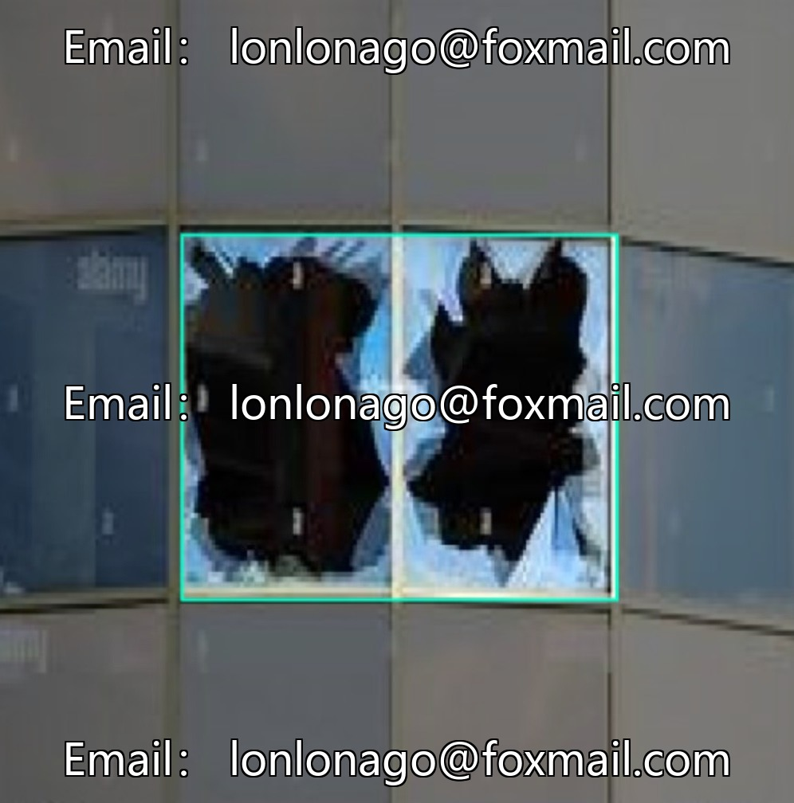
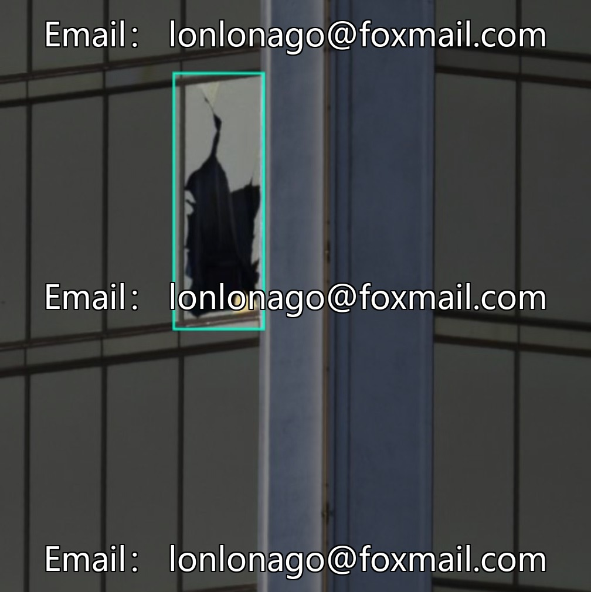
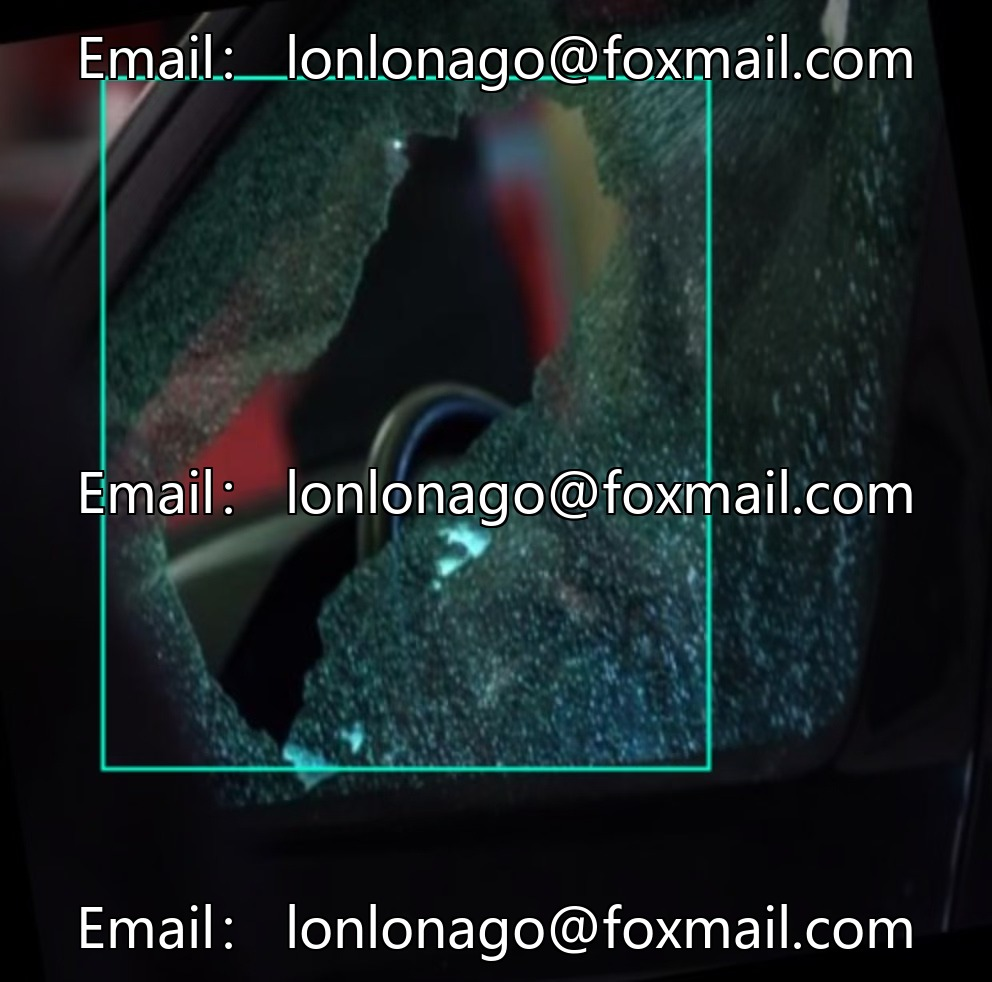
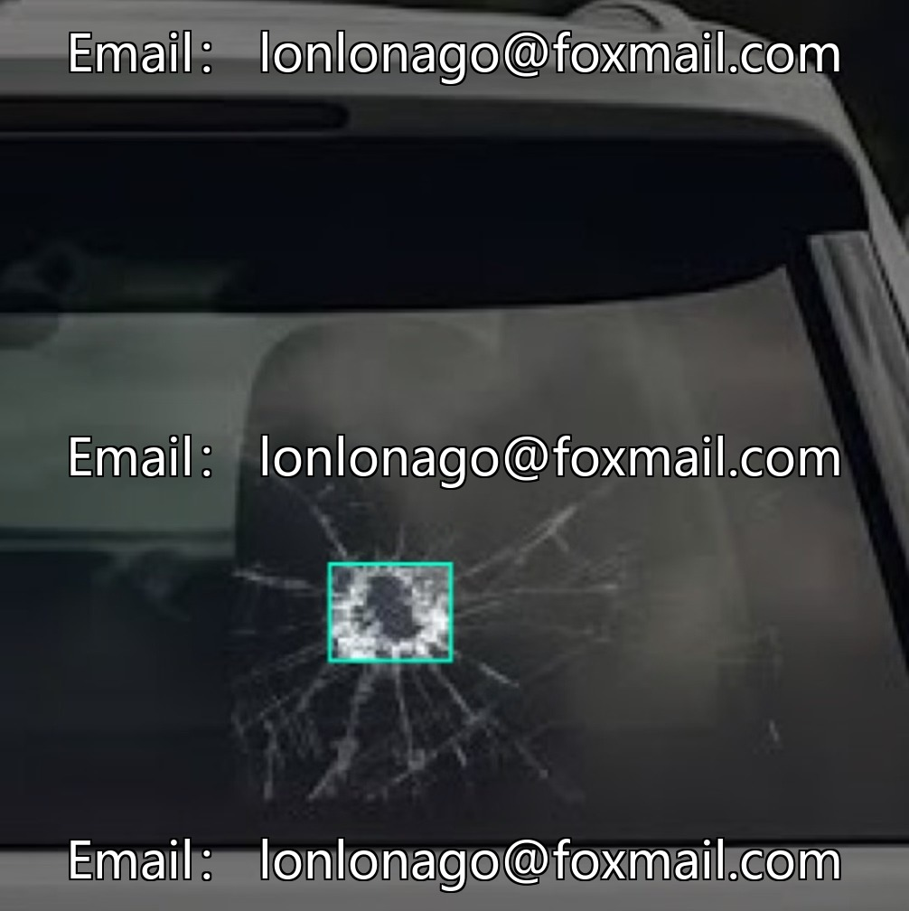

# Glass Breakage Detection Dataset based on YOLO, 600 images of glass breakage and window breakage.

## Body

YOLO-based glass breakage detection dataset, 600 images of glass breaks and window breaks, in YOLO format, with 1 class (breakage type), suitable for research on glass safety monitoring, target detection model development, and the identification system of glass breaks in the field of architecture and automotive. It can also serve as a practical material for computer vision data annotation.

Data covers different angles and lighting conditions, supports model training and validation, reduces the cost of original data collection in projects, optimizes algorithms.

Virtual materials, once sold, are non-refundable.
Interested friends, click "I want" to proceed.

## Images

## Payment

Here is a pay link on Stripe ( https://buy.stripe.com/3cs8yP7sY87d0vu9AB ). Please contact me lonlonago@foxmail.com after funding $89, and I will send you a complete data files , thank you!

